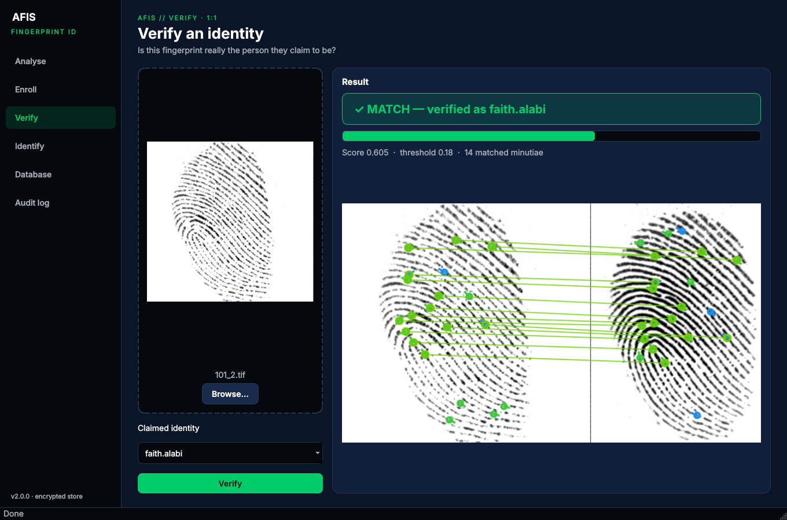
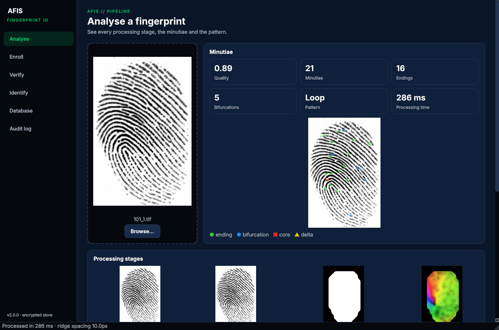
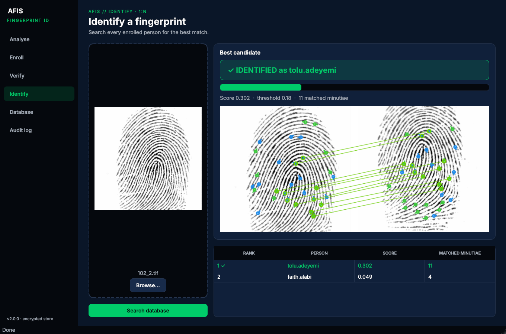
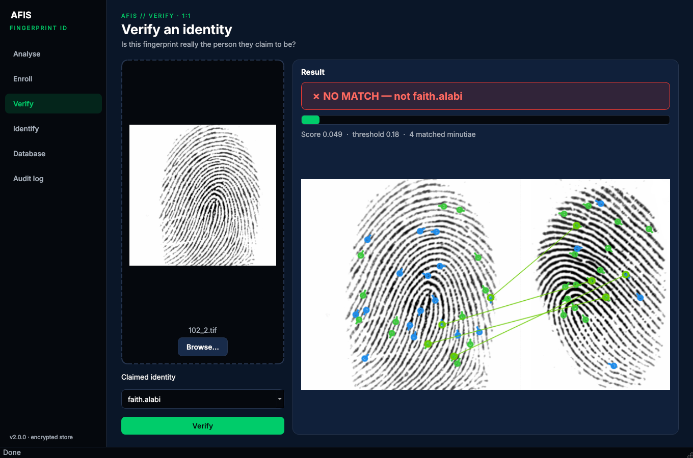
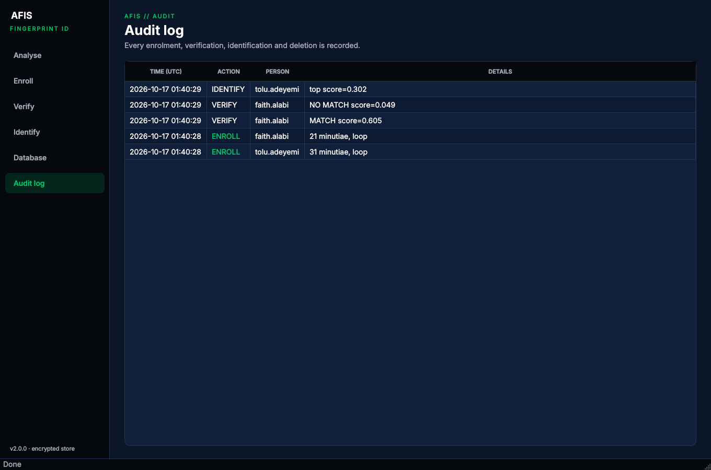
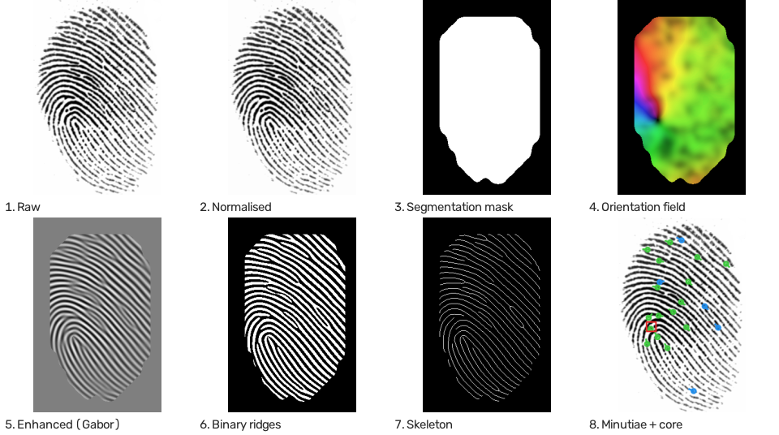
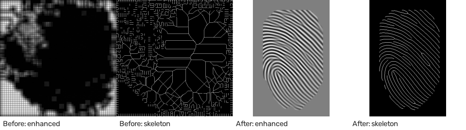
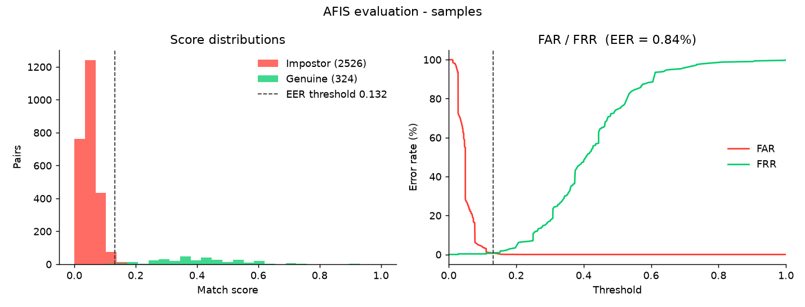

# AFIS – Automated Fingerprint Identification System

A complete fingerprint recognition system in Python: image enhancement, minutiae extraction, rotation-invariant matching, an **encrypted** template database with an audit log, a desktop GUI, a CLI, and an evaluation suite that measures accuracy with standard biometric metrics.

Built by **Faith Alabi** ([SPACEIO](https://github.com/thespaceio)) as a security-engineering portfolio project.



## Highlights

- **End-to-end pipeline**: segmentation → orientation field → ridge frequency → Gabor enhancement → skeleton → minutiae → core/delta detection → pattern class
- **Matching that handles rotation and placement**: local minutiae structures propose alignments, which are refined with a least-squares (Kabsch) fit
- **Measured accuracy**: EER 0.84% on 2,850 comparisons (see [Accuracy](#accuracy) for what that data is)
- **Security by design**: templates and images encrypted at rest (Fernet), SHA-256 integrity check on every template, JSON instead of `pickle`, parameterised SQL, audit log of every enrol/verify/identify/delete
- **Fast**: ~0.3 s to process a 500 dpi print, ~4 ms per comparison
- **Desktop app** (PySide6) with a stage-by-stage pipeline viewer, plus a scriptable CLI and Python API
- **Tested**: 19 pytest tests, including tamper detection and a headless GUI run

## Screenshots

| Analyse: every pipeline stage | Identify: 1:N search |
|---|---|
|  |  |
| **Verify: impostor rejected** | **Audit log** |
|  |  |

## How it works



| Stage | Method |
|---|---|
| Segmentation | Block standard deviation with an Otsu threshold, largest connected region, holes filled |
| Normalisation | Zero mean / unit variance over the finger area only |
| Orientation field | Gradient structure tensor, smoothed in the **doubled-angle** domain so 0° and 180° don't cancel out; coherence as a reliability measure |
| Ridge frequency | Each 32 px block is rotated so ridges are vertical, projected, and the peak spacing measured |
| Enhancement | Bank of 60 even-symmetric Gabor filters (every 3°) tuned to the measured ridge wavelength (Hong, Wan & Jain 1998) |
| Thinning | Binarise (ridges = filter response < 0), remove fragments, skeletonise |
| Minutiae | Crossing number (CN 1 = ending, CN 3 = bifurcation); direction from ridge tracing; removes border points, spurs, short ridges, broken ridges and bridges |
| Singular points | Poincaré index with differences wrapped to ±π/2 (ridge orientation is defined modulo π) → cores, deltas, and arch / loop / whorl |
| Matching | k-nearest-neighbour local structures (distance, radial angle, relative direction) → candidate alignments → one-to-one pairing within 12 px / 25° → Kabsch refinement → score m² / (n₁·n₂) over the overlap |

### What changed in v2

Version 1 couldn't run (`main.py` imported a deleted module), and its output was noise. The Gabor filters used a 1-pixel wavelength and were rotated 90°, binarisation kept valleys instead of ridges, the simplified thinning left blobs, and core detection wrapped angles by 2π. Genuine pairs scored 0.22 against 0.19 for impostors.



## Accuracy

`scripts/evaluate.py` scores every genuine pair (same finger) and impostor pair (different fingers), then reports FAR, FRR and the equal error rate (EER).



| Metric | Value |
|---|---|
| Genuine / impostor comparisons | 324 / 2,526 |
| Equal error rate | **0.84 %** |
| At the default threshold (0.18) | FAR 0.04 % · FRR 3.4 % |
| FRR when FAR = 1 % | 0.6 % |
| Processing / matching time | 0.42 s per image / 4 ms per comparison |

**How to read this honestly:** the data is 6 real prints (4 from FVC2002 DB1, 2 others), 8 synthetic impressions per finger (rotation ±25°, translation, skin-elasticity distortion, dry/wet pressure, noise, partial capture), and mirrored prints as extra fingers. It shows that the pipeline and matcher work and are tuned sensibly. Error rates on a full real database such as **FVC2002 DB1_B** will be higher. Reproduce or extend with:

```bash
python scripts/evaluate.py path/to/FVC2002/DB1_B                     # standard FVC protocol
python scripts/evaluate.py samples --augment 8 --mirror --all-impostors
```

The script writes `results/summary.json` and `results/score_report.png`, and reports the threshold for a target false-accept rate.

## Security design

| Concern | What AFIS does |
|---|---|
| Templates at rest | Encrypted with Fernet (AES-128-CBC + HMAC-SHA256). The key comes from `AFIS_KEY` or an owner-only `*.key` file next to the database |
| Tampering | Each template carries a SHA-256 hash of its minutiae. Decryption failures and hash mismatches raise `TemplateIntegrityError` |
| Unsafe deserialisation | Templates are JSON. v1 used `pickle`, which can execute code from a tampered database |
| SQL injection | Every query is parameterised |
| Accountability | `audit_log` table records enrolments, verifications (with score), identifications and deletions |
| Data minimisation | Set `store_images=False` to keep templates only. Images are stored (encrypted) solely to draw match visualisations |
| Secrets in git | `.gitignore` excludes `*.db`, `*.key` and fingerprint images |

## Getting started

Requires Python 3.9+.

```bash
git clone https://github.com/thespaceio/AFIS.git
cd AFIS
python -m venv .venv && source .venv/bin/activate      # Windows: .venv\Scripts\activate
pip install -r requirements.txt
```

Get sample prints: download **FVC2002 DB1_B** (free) and extract the `.tif` files into `samples/` (see [samples/README.md](samples/README.md)).

### Desktop app

```bash
python -m afis.gui
```

The database is stored in `~/.afis/` (override with `AFIS_DB`). Drag and drop images onto any screen.

### Command line

```bash
python -m afis                                   # interactive menu
python -m afis enroll alice samples/101_1.tif --finger 2
python -m afis verify alice samples/101_2.tif    # exit code 0 = verified
python -m afis identify samples/101_3.tif --top 3
python -m afis stats
python -m afis delete alice
```

### Python API

```python
from afis import AFISSystem

afis = AFISSystem("afis_templates.db")
afis.enroll("samples/101_1.tif", "alice", finger_position=2)

is_match, score, details = afis.verify("samples/101_2.tif", "alice")
ranked = afis.identify("samples/101_3.tif", top_k=3)      # [(person_id, score, details), ...]

p = afis.process("samples/101_1.tif")                     # every intermediate stage
print(len(p.minutiae), p.global_features["pattern_type"], p.result.quality)
```

## Project structure

```
afis/
  acquisition.py    load and validate images (native resolution, no stretching)
  preprocessing.py  segmentation, orientation, frequency, Gabor enhancement, skeleton
  features.py       minutiae (crossing number + tracing + spurious removal), cores/deltas, pattern
  matching.py       local structures, alignment, pairing, Kabsch refinement, scoring
  template.py       JSON templates with integrity hash
  database.py       encrypted SQLite store and audit log
  system.py         AFISSystem: enrol / verify / identify
  evaluation.py     FAR, FRR, EER, plots, synthetic impressions
  visualization.py  minutiae and match drawings
  cli.py            command-line interface
  gui/              PySide6 desktop app
scripts/
  evaluate.py         accuracy evaluation
  gui_screenshots.py  regenerates docs/ screenshots off-screen
tests/                pytest suite
```

## Tests

```bash
pip install pytest
pytest                                  # tests needing sample prints are skipped if samples/ is empty
AFIS_SAMPLES=samples pytest -v
```

## Limitations and ethics

- Built for learning and demonstration, **not** for real access control or forensic use without a much larger evaluation.
- Single-resolution assumptions (~500 dpi). Latent prints and very low-quality images are out of scope.
- Fingerprints are sensitive, irrevocable biometric data. Only enrol prints with consent, keep the key file private, and follow the applicable data protection law (e.g. NDPA in Nigeria, GDPR in the EU).

## References

- Hong, Wan & Jain (1998). *Fingerprint image enhancement: algorithm and performance evaluation*. IEEE TPAMI 20(8).
- Maltoni, Maio, Jain & Prabhakar. *Handbook of Fingerprint Recognition*, Springer.
- Jiang & Yau (2000). *Fingerprint minutiae matching based on the local and global structures*. ICPR.
- FVC2002 – Second International Fingerprint Verification Competition, University of Bologna.

## License

MIT
