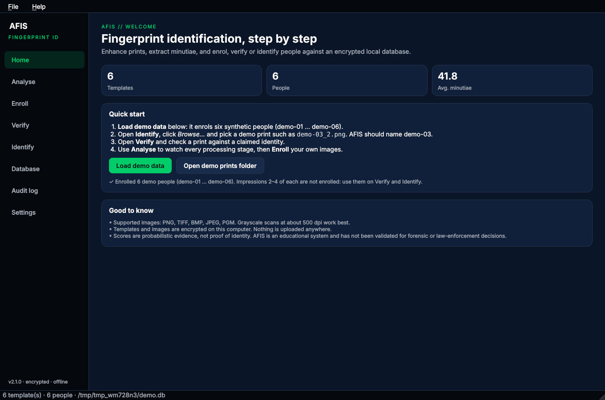
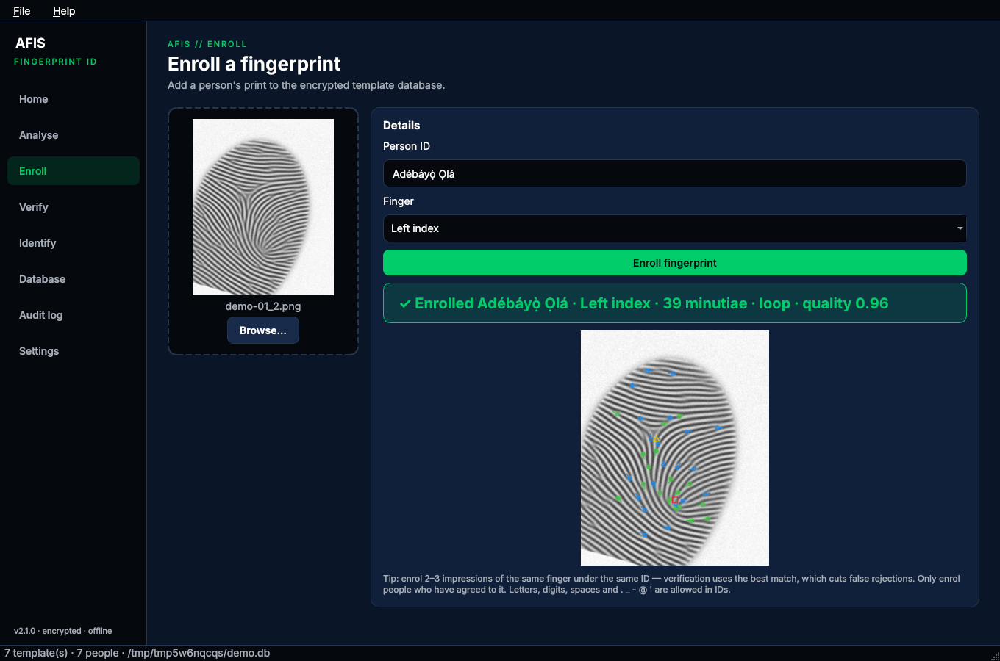
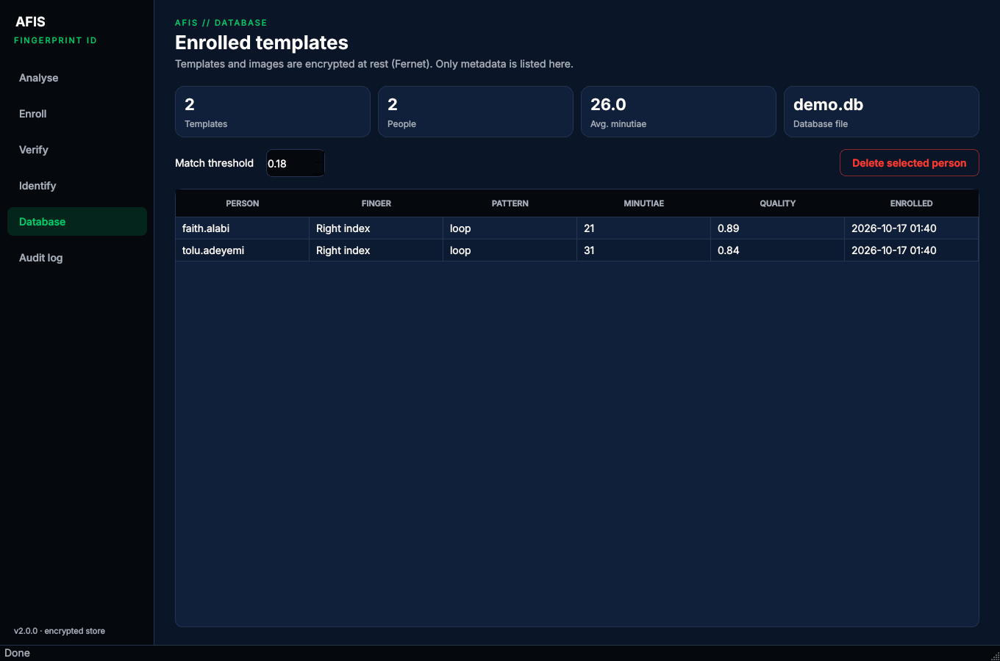
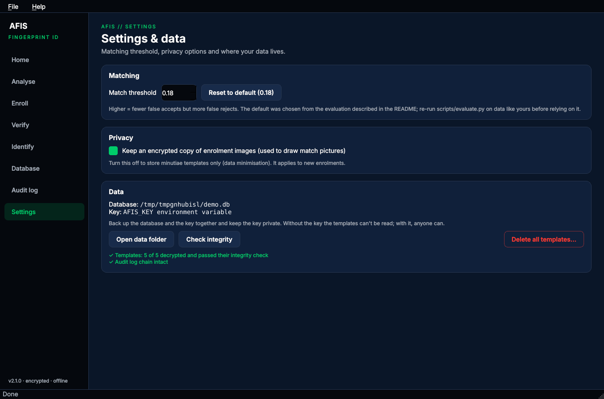

# AFIS – Automated Fingerprint Identification System

[](https://github.com/thespaceio/AFIS/actions/workflows/ci.yml)
[](https://github.com/thespaceio/AFIS/actions/workflows/release.yml)
[](https://github.com/thespaceio/AFIS/actions/workflows/evaluate.yml)
[](LICENSE)

A desktop app for learning fingerprint recognition. It enhances fingerprint images, extracts minutiae, and lets you **enrol**, **verify** (1:1) and **identify** (1:N) people against an **encrypted, local** template database with a tamper-evident audit log. Everything runs offline on your computer.

Built by **Faith Alabi** ([SPACEIO](https://github.com/thespaceio)) as an educational and security-engineering project.

> **Responsible use.** Match scores are *probabilistic*. AFIS is educational software and has **not** been validated for forensic, legal or law-enforcement decisions. Only enrol people who have given informed consent. See [Security & privacy](#security--privacy).


## Contents
[Download & install](#download--install) · [Quick start](#quick-start) · [Features](#features) · [Screenshots](#screenshots) · [Command line](#command-line) · [How it works](#how-it-works) · [Accuracy](#accuracy) · [Security & privacy](#security--privacy) · [Troubleshooting](#troubleshooting) · [Development](#development) · [Licence](#licence)

## Download & install

### Option 1: ready-made app (no Python needed)

Get the latest files from **[Releases](https://github.com/thespaceio/AFIS/releases/latest)**:

| Platform | Download | Start |
|---|---|---|
| **Linux** x86-64 (Kali, Ubuntu, Debian, Fedora, …) | `AFIS-<version>-x86_64.AppImage` | `chmod +x AFIS-*.AppImage && ./AFIS-*.AppImage` |
| Linux, with a menu entry | `AFIS-<version>-linux-x86_64.tar.gz` | `tar xzf AFIS-*.tar.gz && cd AFIS && ./install.sh`, then `afis-gui` |
| **Windows** 10 / 11 (x64) | `AFIS-<version>-windows-x64.zip` | Unzip, then double-click `AFIS\AFIS.exe` |
| **macOS** 13+ (Apple silicon) | `AFIS-<version>-macos-arm64.zip` | Unzip, move `AFIS.app` to Applications, then right-click it and choose **Open** |

The builds are not code-signed. Windows SmartScreen asks you to click **More info → Run anyway**, and macOS asks you to confirm **Open** the first time. You can check downloads against `SHA256SUMS.txt` on the release page.

On a minimal Linux install (Kali light, servers with a desktop added), the window needs a few Qt libraries:

```bash
sudo apt install libegl1 libxkbcommon-x11-0 libxcb-cursor0 libfontconfig1 libdbus-1-3
```

### Option 2: install from source (Linux / macOS)

Needs Python 3.9 or newer. On Debian, Ubuntu or Kali you may also need `sudo apt install python3-venv`.

```bash
git clone https://github.com/thespaceio/AFIS.git
cd AFIS
./install.sh          # private virtual environment + app-menu entry + `afis-gui` / `afis` commands
afis-gui
```

### Option 3: pip / pipx (any OS, including Windows)

```bash
pipx install git+https://github.com/thespaceio/AFIS.git      # or: pip install git+https://...
afis-gui
```

Developers can use `python -m venv .venv && . .venv/bin/activate && pip install -e ".[dev]"`.

### Uninstall

| Installed with | Remove |
|---|---|
| AppImage | Delete the file |
| tar.gz bundle | `~/.local/opt/afis/uninstall.sh` |
| `install.sh` (source) | `./uninstall.sh` |
| Windows / macOS bundle | Delete the `AFIS` folder or `AFIS.app` |
| pip / pipx | `pipx uninstall afis` / `pip uninstall afis` |

Uninstalling **keeps your data**. To delete the database, key and settings as well, run `./uninstall.sh --purge` (you'll be asked to type `DELETE`), or remove the data folder by hand:

| OS | Data folder |
|---|---|
| Linux | `~/.local/share/afis/` |
| macOS | `~/Library/Application Support/AFIS/` |
| Windows | `%APPDATA%\AFIS\` |

### System requirements

- **OS:** 64-bit Linux with glibc 2.35 or newer (Kali Rolling, Ubuntu 22.04+, Debian 12+, Fedora 36+), Windows 10/11, or macOS 13+ on Apple silicon. Other systems can use the source install.
- **Hardware:** any CPU from the last ~10 years, 4 GB RAM, about 600 MB of disk for the app.
- **Display:** 1024 × 700 or larger.
- **Images:** grayscale fingerprint scans at roughly 500 dpi (PNG, TIFF, BMP, JPEG, PGM). Phone photos of fingers are not supported.

## Quick start

1. Open AFIS. The first time, it explains responsible use. Click **I understand**.
2. On **Home**, click **Load demo data**. This enrols six *synthetic* people (`demo-01` … `demo-06`) from prints that belong to no one.
3. Open **Identify**, click **Browse…** (it opens the demo folder) and choose `demo-03_2.png`, then click **Search database**. AFIS should name **demo-03** and show the matched minutiae.
4. Open **Verify**, choose `demo-02_3.png`, type `demo-02` and click **Verify** (a match). Then try `demo-05` (no match).
5. Use **Analyse** to see every processing stage, and **Enroll** to add your own images.

You can also drag and drop images onto any page. Keyboard shortcuts: **Ctrl+1 … Ctrl+8** switch pages, and **Ctrl+Q** quits.

## Features

- **Analyse:** shows every stage of the pipeline (segmentation, orientation field, Gabor enhancement, binarisation, skeleton), plus the minutiae, cores and deltas, pattern class (arch, loop or whorl) and a quality score.
- **Enroll** with quality checks. Images that are blurry, noisy or not fingerprints are rejected with a reason.
- **Verify (1:1)** and **Identify (1:N, ranked top 5)**, with a score bar and a side-by-side picture of the matched minutiae.
- **Database:** filter people, delete one template or a whole person (with confirmation), and view statistics.
- **Audit log** of every enrolment, verification, identification and deletion, with a one-click integrity check and CSV export.
- **Settings:** match threshold, a templates-only mode with no stored images, data and key locations, integrity check, and delete-all protected by typing `DELETE`.
- **Encrypted storage** (Fernet), integrity hashes that bind each template to its person, and an HMAC-chained audit log (see [SECURITY.md](SECURITY.md)).
- **Command line and Python API** covering every feature.
- **Evaluation tools:** FAR, FRR and EER on any dataset, plus a synthetic fingerprint generator.

## Screenshots

All screenshots show the real app, generated by [`scripts/gui_screenshots.py`](scripts/gui_screenshots.py) with the bundled synthetic prints.

| Home: quick start and demo data | Analyse: every pipeline stage |
|---|---|
|  |  |
| **Verify: genuine match** | **Verify: impostor rejected** |
|  |  |
| **Enroll** | **Database** |
|  |  |
| **Audit log with chain check** | **Settings & data** |
|  |  |

## Command line

`afis` uses the same database and settings as the app.

```bash
afis demo                                   # enrol the synthetic demo people
afis enroll alice scan1.png --finger 2      # finger 0-10 (2 = right index)
afis verify alice scan2.png                 # exit code 0 = match, 1 = no match, 2 = error
afis identify scan3.png --top 3             # exit code 0 = candidate found, 1 = none
afis analyse scan1.png                      # quality, minutiae, pattern
afis list | afis stats | afis check         # list templates, statistics, integrity check
afis audit --limit 20 | afis audit --export audit.csv
afis delete alice                           # asks for confirmation (--yes to skip)
afis delete-all                             # asks you to type DELETE
afis info                                   # where the database, key and settings live
afis --threshold 0.25 verify alice scan2.png
afis                                        # interactive menu
```

The prebuilt bundles include the CLI too: `./afis` on Linux, `afis-cli.exe` on Windows, and `AFIS.app/Contents/MacOS/afis-cli` on macOS.

### Python API

```python
from afis import AFISSystem

afis = AFISSystem("my.db")                       # key created next to it (or set AFIS_KEY)
afis.enroll("scan1.png", "alice", finger_position=2)
is_match, score, details = afis.verify("scan2.png", "alice")
ranked = afis.identify("scan3.png", top_k=3)     # [(person_id, score, details), ...]
p = afis.process("scan1.png")                    # every intermediate stage
print(len(p.minutiae), p.global_features["pattern_type"], p.result.quality)
```

### Configuration

| Variable | Effect |
|---|---|
| `AFIS_HOME` | Data folder (database, key, settings) |
| `AFIS_DB` | Database file; the key file sits next to it |
| `AFIS_KEY` | Fernet key to use instead of the key file (keeps the key off disk) |

## How it works


| Stage | Method |
|---|---|
| Segmentation | Block standard deviation with an Otsu threshold, the largest connected region, holes filled |
| Normalisation | Zero mean / unit variance over the finger area only |
| Orientation field | Gradient structure tensor, smoothed in the doubled-angle domain, with coherence as a reliability measure |
| Ridge frequency | Each 32 px block is rotated so ridges are vertical and projected, then the peak spacing is measured |
| Quality | Finger area × ridge-flow coherence × the share of blocks with a plausible ridge spacing |
| Enhancement | A bank of 60 even-symmetric Gabor filters tuned to the measured ridge wavelength (Hong, Wan & Jain 1998) |
| Thinning | Binarise, remove fragments, skeletonise |
| Minutiae | Crossing number with traced directions. Removes border points, spurs, short ridges, broken ridges and bridges |
| Singular points | Poincaré index with differences wrapped to ±π/2 gives cores and deltas, and from them arch, loop or whorl |
| Matching | k-nearest-neighbour local structures give candidate alignments, then one-to-one pairing within 12 px / 25° and a Kabsch refinement. Score = m² / (n₁·n₂) over the overlap |

Synthetic prints ([`afis/synthetic.py`](afis/synthetic.py)) follow SFinGe (Cappelli, Maio & Maltoni 2000): a zero-pole orientation model (Sherlock & Monro 1993), with ridges grown from random seeds by iterative Gabor filtering, and then placement, rotation, skin distortion, pressure and noise for each impression.

## Accuracy

Run `python scripts/evaluate.py` on your own data to measure FAR, FRR and EER. Results on FVC2002 and on synthetic fingers will be added here when the evaluation runs finish.

## Security & privacy

Summary below. See [SECURITY.md](SECURITY.md) for the full design and its limits.

| Concern | What AFIS does |
|---|---|
| Templates and images at rest | Encrypted with Fernet (AES-128-CBC + HMAC-SHA256) |
| Key management | Key file created with owner-only permissions next to the database, or supplied through `AFIS_KEY`. A wrong key is rejected at start-up, and a missing key file is never silently replaced |
| Tampering | Each template's SHA-256 hash covers its person ID, template ID and minutiae, and must match its database row. Swapped or edited templates are rejected |
| Unsafe deserialisation | JSON only (v1 used `pickle`, which can execute code) |
| SQL injection | Parameterised queries everywhere |
| Accountability | HMAC hash-chained audit log, with an encrypted chain head that also detects truncation |
| Deletion | Confirmation dialogs, typed `DELETE` for delete-all, `secure_delete` overwrites deleted data, and the uninstaller keeps data unless you pass `--purge` |
| Data minimisation | **Settings → Privacy** turns off image storage (templates only) |
| Secrets in git | `.gitignore` excludes `*.db`, `*.key`, `settings.json`, `samples/*`, `data/`, `results/`. No real fingerprints are committed; the demo prints are synthetic |
| Network | None. AFIS never connects to the internet |

**Limits:** anyone with both the database and its key can read the templates. The audit chain shows tampering but can't stop someone who holds the key from rewriting it. There are no user accounts. Fingerprint templates can't be "reset" like passwords.

**Ethics and law:** fingerprints are biometric personal data. Laws such as the GDPR, BIPA and the NDPR/NDPA may require informed consent, a stated purpose and retention limits. Don't use AFIS to identify people without their knowledge, and never as the sole basis for a decision about someone.

## Troubleshooting

| Problem | Fix |
|---|---|
| Linux: `qt.qpa.plugin: Could not load the Qt platform plugin "xcb"` | `sudo apt install libxcb-cursor0 libxkbcommon-x11-0 libegl1 libfontconfig1` |
| Linux: `libEGL.so.1: cannot open shared object file` | `sudo apt install libegl1 libgl1` |
| AppImage won't start: "FUSE" error | `sudo apt install libfuse2`, or run `./AFIS-*.AppImage --appimage-extract-and-run` |
| Wayland session renders oddly | `QT_QPA_PLATFORM=xcb afis-gui` |
| `./install.sh`: "no 'venv' module" | `sudo apt install python3-venv` |
| `afis: command not found` after installing | Add `~/.local/bin` to `PATH`: `echo 'export PATH=$HOME/.local/bin:$PATH' >> ~/.bashrc` |
| "The encryption key does not match the database" | You're using a different key from the one that created the database. Restore the right `afis_templates.key` next to the `.db`, or unset `AFIS_KEY` |
| "…its key file … is missing" | Restore the `.key` file from your backup. Without it the templates can't be decrypted. To start fresh, move the old `.db` away |
| "Image quality too low" / "Only N minutiae found" | Use a sharper, larger, ~500 dpi grayscale scan of a single fingertip |
| "could not be read: the file is damaged or not an image" | The file is corrupt or not an image. Supported formats: PNG, TIFF, BMP, JPEG, PGM |
| Genuine prints are rejected | Enrol 2–3 impressions per finger (verify uses the best one), or lower the threshold slightly under **Settings** (this increases false accepts) |
| Windows: "Windows protected your PC" | Click **More info → Run anyway** (the app isn't code-signed) |
| macOS: "cannot be opened because the developer cannot be verified" | Right-click `AFIS.app` → **Open**, or `xattr -dr com.apple.quarantine AFIS.app` |

## Development

```bash
pip install -e ".[dev]"
python -m pytest -q                          # 101 tests: engine, security, CLI, GUI (off-screen), data handling
python -m afis.gui --smoke-test              # opens the real window, enrols and identifies demo prints, exits
python scripts/evaluate.py --synthetic 50    # accuracy on generated fingers
python scripts/evaluate.py path/to/FVC2002/DB1_B path/to/FVC2002/DB2_B --all-impostors
python scripts/gui_screenshots.py docs       # regenerate README screenshots
pyinstaller packaging/afis.spec --noconfirm  # build the desktop bundle into dist/
```

The tests use the bundled synthetic prints, so they need no external data. If FVC2002 images are in `samples/` (see [samples/README.md](samples/README.md)), a few extra real-print tests run as well.

CI ([`.github/workflows`](.github/workflows)):
- **CI** runs the tests on Linux (Python 3.9, 3.11, 3.12, 3.13), Windows and macOS, a GUI smoke test, and a clean wheel install plus an `install.sh` round trip.
- **Build & release** builds and smoke-tests the bundles for each platform, and publishes a GitHub Release when a new version reaches `main` or a `v*` tag is pushed.
- **Accuracy (FVC2002)** downloads the public FVC2002 databases at run time and reports EER, FAR and FRR.

Releasing: bump `__version__` in `afis/__init__.py`, update `CHANGELOG.md` and `packaging/RELEASE_NOTES.md`, and merge to `main`.

### Project structure

```
afis/
  acquisition.py    load and validate images (size limits, decode by content)
  preprocessing.py  segmentation, orientation, frequency, Gabor enhancement, skeleton, quality
  features.py       minutiae, cores/deltas, pattern class
  matching.py       local structures, alignment, pairing, Kabsch refinement, scoring
  template.py       JSON templates with an identity-bound integrity hash
  database.py       encrypted SQLite store, key check, HMAC-chained audit log
  system.py         AFISSystem: enrol / verify / identify / delete / integrity check
  config.py         per-user data folder and settings
  synthetic.py      SFinGe-style synthetic fingerprint generator
  demo.py, demo_prints/   bundled synthetic demo prints
  evaluation.py     FAR, FRR, EER, plots, synthetic impressions
  visualization.py  minutiae and match drawings
  cli.py            command-line interface
  gui/              PySide6 desktop app
packaging/          PyInstaller spec, Linux install scripts, release notes
scripts/            evaluate.py, gui_screenshots.py, make_figures.py, make_demo_prints.py
tests/              pytest suite
```

## Licence

[MIT](LICENSE) © Faith Alabi (SPACEIO). FVC2002 images are © the University of Bologna and are not distributed with this project. The evaluation workflow downloads them from the official site for testing only.
